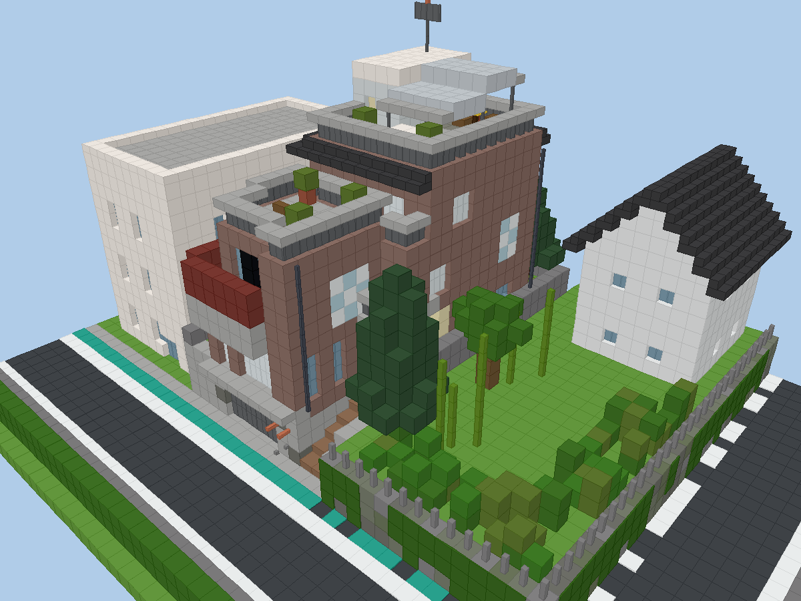

# 野獣邸 再現（Minecraft 統合版）

公開されている写真3枚をもとに、通称「野獣邸」を Minecraft 統合版（Bedrock Edition）に再現する個人用のプロジェクト。
コマンド1つで建つビヘイビアパック（`.mcpack`）と、それを生成する Python のジェネレータからなる。

> 個人で遊ぶためのもの。配布・公開はしない。住所などの情報は一切含めていない。
> 実物は今も使われている建物で、近隣住民が迷惑行為に悩まされている。現地へは行かないこと。



## すぐ遊ぶ
`dist/yajuutei_hybrid_latest.mcpack`（1.26.50 以降）または `dist/yajuutei_hybrid_compat.mcpack`（1.21.130〜1.26.40）を開いてインポートし、
チートをオンにしたフラットのワールドでパックを有効にして:
```
/function yajuutei/setup
/function yajuutei/build_all
```
詳しくは [docs/HOW_TO_PLAY.md](docs/HOW_TO_PLAY.md)。

## できあがり
- 大きさ: 敷地と周辺を含めて 49×25×39 ブロック。建物は幅 10 × 奥行き 20 × 高さ 24（アンテナまで）。1ブロック＝0.8m
- 構成: 地下階（ガレージ・地下室）、1階（玄関・リビング・台所）、2階（浴室・寝室・書斎）、3階（和室・納戸）、塔屋、屋上（ガラス屋根・日光浴のマット）
- 前面の増築棟（ガレージ・曲面バルコニー・赤茶色のルーバー）は 2020年代の姿。`ERA=2001` 版はこれを作らず、門付きの階段にした
- 内装は作中の静止画が無いため推測（[docs/assumptions.md](docs/assumptions.md)）。部屋ごとに作り直せる

## 文書
| ファイル | 内容 |
|---|---|
| [MASTER_PROMPT.md](MASTER_PROMPT.md) | AI への指示書（このプロジェクトの仕様） |
| [docs/evidence.md](docs/evidence.md) | 調査台帳（写真から読み取ったこと、寸法、確度） |
| [docs/assumptions.md](docs/assumptions.md) | 推測で決めたことと差し替え方 |
| [docs/open_issues.md](docs/open_issues.md) | 未解決・ゲーム内で確認してほしいこと |
| [docs/checklist_result.md](docs/checklist_result.md) | 品質チェックの結果 |
| [docs/params.md](docs/params.md) | 採用したパラメータ |
| [docs/plans/](docs/plans/) | 各階の平面図（テキストと画像） |
| [docs/previews/](docs/previews/) | 写真と同じアングルの確認用の描画 |
| [refs/README.md](refs/README.md) | 資料の一覧と出典 |

## 作り直す
```
make          # パック・平面図・確認用の画像を作り、dist/ にパックを置く
make test     # 自動テスト（ブロック定義・コマンド・通行・手すり・住所が入っていないか）
make verify   # Mojang 公式のブロック定義と突き合わせ直す
```
色を変えるなら `src/palette.py`、時代や縮尺なら `src/params.py`、部屋の内装なら `src/model/rooms/`。
